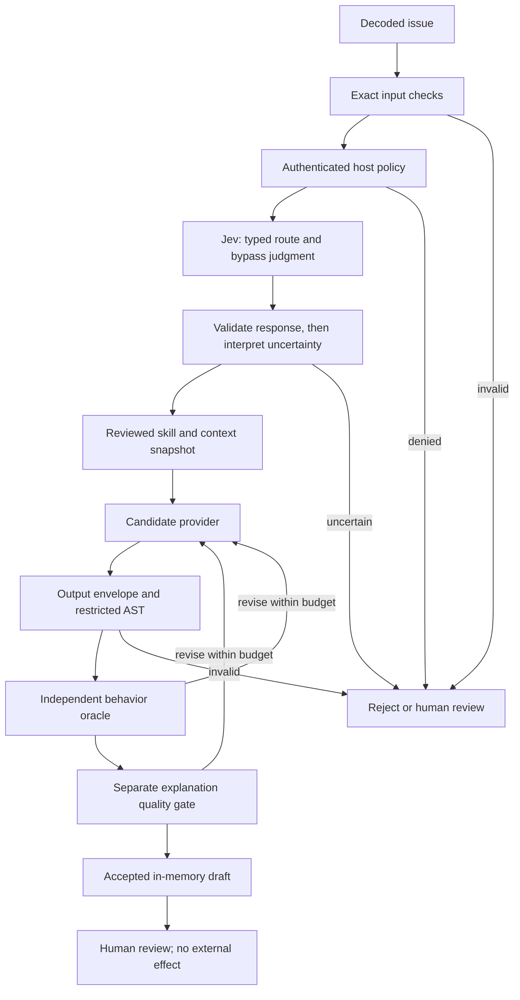

# Software Engineering with AI-Core, Jev & Skills

The runnable companion to **15 bilingual engineering lessons on [anirach.com](https://anirach.com/blog/#series-ai-engineering)**. Start with familiar functions; end with a guarded issue-to-patch workflow whose permissions, decisions and outcomes are inspectable.

The capstone is **Patch Workbench**: an issue selects a reviewed pricing skill, a candidate is proposed, exact checks inspect its structure and behavior, and a separate quality gate assesses the explanation. Its output is an in-memory draft for human review. It does not open a PR, merge, deploy, write a repository, or execute generated Python.

## Quick start

Python **3.11+**, Git, and a terminal. No packages, API keys or network access are needed after cloning. Windows: replace `python3` with `py -3` if needed.

```sh
git clone https://github.com/Anirach/ai-core-engineering-workbench.git
cd ai-core-engineering-workbench
python3 -m unittest discover -v
python3 -m workbench.lesson 1
python3 -m workbench.lesson all
python3 -m workbench.evaluation
```

Run from the repository root. You can also run one standalone entry point with `python3 -m lessons.part_01`. No installation or virtual environment is required. The release tag `v1.0.0` identifies the original tested course snapshot.

## Architecture



`workbench/core.py` is the functional core. `runtime.py` coordinates provider calls, gates, revisions and trace assembly. `jev.py` is the optional HTTP decision adapter. `skills/pricing-patch/SKILL.md` describes the task; the host-side `SKILL` contract enforces scope. The small duplication is explicit and must be reviewed together when changing the skill.

## Three visibly different outcomes

| Experiment | Command | Key result |
|---|---|---|
| Malformed issue | `python3 -m workbench.lesson 4` | `reject`, zero provider calls |
| Forbidden merge action | `python3 -m workbench.lesson 8` | `action_denied`, zero effects |
| Valid syntax, wrong arithmetic | `python3 -m workbench.lesson 11` | shape passes, behavior requests revision |
| Correct behavior, weak explanation | `python3 -m workbench.lesson 12` | final `review` |
| Wrong candidate followed by correct candidate | `python3 -m workbench.lesson 13` | accepted draft, 2 attempts, 4 logical calls |
| Passing draft, missing release evidence | `python3 -m workbench.lesson 15` | runtime accepted, release review |

All default decisions are **scripted fixtures**. They prove control-flow behavior, not Jev accuracy, detection quality, latency or cost. Unknown usage and live metrics remain `null`. Logical provider calls are not HTTP calls or token counts.

## Lesson-to-code map

Each lesson links the implementation, a matching boundary test and an exercise. Tests live in `tests/test_boundaries.py`.

| Part | Website | Companion | Matching test |
|---|---|---|---|
| 01 | [Mental Model](https://anirach.com/blog/ai-engineering-old-to-new.html) | [Code](lessons/part_01.py) · [Exercise](exercises/part_01.md) | `test_shape_does_not_imply_behavior` |
| 02 | [Functional Core](https://anirach.com/blog/ai-engineering-functional-core.html) | [Code](lessons/part_02.py) · [Exercise](exercises/part_02.md) | `test_permission_stops_before_inference` |
| 03 | [Contracts](https://anirach.com/blog/ai-engineering-contracts.html) | [Code](lessons/part_03.py) · [Exercise](exercises/part_03.md) | `test_accept_still_has_zero_effects` |
| 04 | [Input Checks](https://anirach.com/blog/ai-engineering-input-checks.html) | [Code](lessons/part_04.py) · [Exercise](exercises/part_04.md) | `test_input_stops_before_inference` |
| 05 | [Typed Decisions](https://anirach.com/blog/ai-engineering-jev-decisions.html) | [Code](lessons/part_05.py) · [Exercise](exercises/part_05.md) | `test_invalid_probability_rejected` |
| 06 | [Skill Contracts](https://anirach.com/blog/ai-engineering-skills.html) | [Code](lessons/part_06.py) · [Exercise](exercises/part_06.md) | `test_semantic_review_cannot_generate` |
| 07 | [Semantic Input](https://anirach.com/blog/ai-engineering-semantic-input.html) | [Code](lessons/part_07.py) · [Exercise](exercises/part_07.md) | `test_semantic_review_cannot_generate` |
| 08 | [Hard Guardrails](https://anirach.com/blog/ai-engineering-guardrails.html) | [Code](lessons/part_08.py) · [Exercise](exercises/part_08.md) | `test_permission_stops_before_inference` |
| 09 | [Context & Evidence](https://anirach.com/blog/ai-engineering-context.html) | [Code](lessons/part_09.py) · [Exercise](exercises/part_09.md) | `test_reproducible_manifest` |
| 10 | [Output Validation](https://anirach.com/blog/ai-engineering-output-checks.html) | [Code](lessons/part_10.py) · [Exercise](exercises/part_10.md) | `test_output_disallows_executable_python_features` |
| 11 | [Behavior Checks](https://anirach.com/blog/ai-engineering-behavior-checks.html) | [Code](lessons/part_11.py) · [Exercise](exercises/part_11.md) | `test_shape_does_not_imply_behavior` |
| 12 | [Quality Gate](https://anirach.com/blog/ai-engineering-quality-gate.html) | [Code](lessons/part_12.py) · [Exercise](exercises/part_12.md) | `test_high_average_does_not_override_low_dimension` |
| 13 | [Bounded Recovery](https://anirach.com/blog/ai-engineering-bounded-repair.html) | [Code](lessons/part_13.py) · [Exercise](exercises/part_13.md) | `test_bounded_repair` |
| 14 | [Evaluation](https://anirach.com/blog/ai-engineering-evaluation.html) | [Code](lessons/part_14.py) · [Exercise](exercises/part_14.md) | `test_fixtures_do_not_claim_model_accuracy` |
| 15 | [Release & Operate](https://anirach.com/blog/ai-engineering-release.html) | [Code](lessons/part_15.py) · [Exercise](exercises/part_15.md) | `test_release_separate_from_runtime` |

## Optional real Jev decisions

The official API contract was checked on **2 November 2026** against [TypeSafe API docs](https://docs.typesafe.ai/api/system-one), [Choice](https://docs.typesafe.ai/primitives/choice), [Noul](https://docs.typesafe.ai/primitives/noul) and [confidence](https://docs.typesafe.ai/confidence). The adapter pins `jev-1.14.0`; verify that your account can use it. No live paid API call was made while authoring this companion.

Set `TYPESAFE_API_KEY` through your shell's secret mechanism, then intentionally opt in:

```sh
python3 -m workbench.live --allow-paid-api
```

This sends a synthetic issue and synthetic summary to `https://api.typesafe.ai/v1/systemone`. It makes real routing and quality decisions, but **generation remains a reviewed local fixture**. Jev does not write code here. `candidate_hash` is a local response-envelope field, not a Jev API field or signature. Provider usage is retained separately; this example does not calculate monetary cost. A genuine generative-model adapter is an extension exercise, not an implemented integration.

The adapter makes no automatic transport retries, follows no redirects, limits response size and uses an HTTP timeout. The shell checks elapsed time before and after calls; it cannot interrupt a blocking call. A production deadline needs cancellation and remaining-time propagation. HTTP 401/422 require configuration/request repair; 429/529 may justify bounded backoff in a separately tested adapter. Any provider failure returns review.

## Limits that matter

- The candidate language is one integer expression using `+ - * //`. AST parsing plus a small interpreter is a teaching language, **not a general Python sandbox**. No `eval`, `exec`, imports or subprocess runs are used for candidates.
- The pricing domain is integer price >= 0 and integer percent in [0,100]. Trusted examples satisfy it; a real service must validate its numeric invocation inputs too.
- Six examples and selected monotonicity checks do not prove correctness for all inputs. Keep an independent oracle and held-out cases.
- Semantic screening and quality judging are fallible. The `.8`, `.2` and `.9` thresholds are illustrative; validate against labeled local traffic and language slices.
- The release checklist is a toy. It does not authenticate signoff or verify CI artifacts. An accepted draft does not authorize production release.
- The manifest is a tutorial subset. Production also needs application/runtime revision, generator configuration, immutable evidence and evaluation data identities.
- There is no persistence, concurrency control, remote idempotency ledger, PR gateway, or production isolation layer. Add those before granting effectful tools.

## Evaluation protocol

Keep development, validation and held-out data disjoint. Freeze thresholds before running held-out evaluation. Report acceptance coverage with accepted-error rate, review/reject rates, language/task slices and human label agreement. Include decisions, generation, retries, fallback, review and rework in cost per successful task. A scripted perfect agreement is not model performance; a missing metric is not zero.

## Troubleshooting

| Symptom | Fix |
|---|---|
| `No module named workbench` | Run from the cloned repository root. |
| Python syntax/version error | Use Python 3.11 or later. |
| Live run requests a key | Offline lessons need no key; live calls require your own TypeSafe account. |
| Live run returns review | Inspect stage/reason and provider usage; check model availability, schema and transport status. Do not weaken a gate to force acceptance. |
| Correct code is rejected | Check the intentionally small language contract. General Python is outside the tutorial scope. |
| Cost or accuracy is `null` | No valid live measurement was collected; retain the unknown value. |

## Extend it responsibly

Add a second reviewed skill, implement a separate generator adapter, build a held-out evaluator, or design a PR gateway with approval bound to repository/base revision/candidate hash. Preserve all gates and re-run the boundary suite. Exercises state expected architectural outcomes without supplying a pretend production guarantee.

MIT licensed. Author: Anirach Mingkhwan. Educational code; source and model documentation can evolve after the pinned snapshot.
